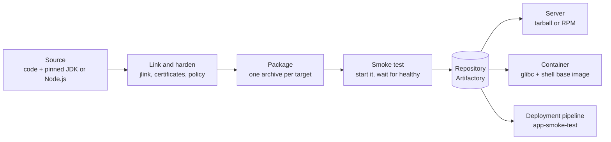

# Ship the runtime with the app

Pippa Newbold · 25 October 2026

The JDK or Node.js your service runs on in production should be the one your tests ran on. These Gradle plugins make that the default: they package each app with its own pinned, trimmed runtime into a single archive that runs the same on a laptop, a server or in a container.

## How Java used to reach production

For most of Java's life the runtime was something the server already had. The JDK carried the compiler, the tools and the headers, with the documentation as a download of its own; the JRE was the runtime alone. The rule was firm: no JDK in production, because nothing should ever be compiled there. Servers got a JRE.

Even so, a Java install was big for its day, and disk and network bandwidth were expensive. Nobody shipped one with each application. It went on once per host, or more often once on a shared filesystem that every host mounted. At one bank these shared software mounts were called HUFs, and every Java process on hundreds of machines ran from the same few directories.

That arrangement had costs everyone learned to live with:

- **Nothing proved an app worked until it was deployed.** CI tested against its own install, often a different build, so the first run on the production runtime was the release itself.
- **`JAVA_HOME` meant nothing on a shared box.** It held whatever the last login or startup script had set, so teams hard-coded paths into the mount, and those paths moved when the mount was reorganised.
- **Every upgrade was everyone's upgrade.** Patching the shared runtime changed every application on it at once. A security update became a change across many teams that none of them had tested, and it was rolled back often enough that people stopped expecting it to stick.

## From the JRE to jlink and jdeps

The shared JRE ended in three steps over four years:

| Release | Year | What changed |
| --- | --- | --- |
| JDK 11 | 2018 | Oracle stops offering a JRE or Server JRE download; [its release notes](https://www.oracle.com/java/technologies/javase/11-relnote-issues.html) point to jlink for smaller custom runtimes |
| JDK 9 | 2017 | The module system arrives with [jlink (JEP 282)](https://openjdk.org/jeps/282), which links a runtime from only the modules an app needs |
| JDK 8 | 2014 | `jdeps` ships, listing which JDK packages and, later, which modules a jar depends on |

The two tools are meant to be used together: jdeps says which modules an app needs, and jlink builds a runtime of exactly those. For this project's sample service the difference is stark. The full Temurin 21 JDK is 353 MB unpacked, the runtime jlink makes for the service is 41 MB, and the whole archive, app and runtime together, is 21 MB to download (linux-x64; a megabyte here is a million bytes). That is small enough to ship with every release, and the shared install, with every problem above, goes away.

The catch is in how jdeps works. It reads the class files and records every class they name, so it sees only what the code refers to directly. As the [OpenJDK wiki](https://wiki.openjdk.org/x/CAESAQ) puts it, dependencies loaded with `Class.forName` or as service providers are not reported. Some of Java's most important modules arrive exactly that way:

- TLS cipher implementations and the elliptic-curve provider (`jdk.crypto.ec`), found through security-provider lookup;
- JNDI and LDAP (`java.naming`), loaded by name from configuration;
- locale data beyond English (`jdk.localedata`), loaded on demand;
- drivers and plugins that frameworks find with `ServiceLoader` or reflection.

A runtime linked from jdeps's list alone starts, passes a quick test, and then fails in production the first time a request needs one of these, often on a code path no test reached. That makes a trimmed runtime safe only when something actually runs the app on it before release.

## Two ways to ship Java, with nothing in common

Today most organisations run Java in two worlds at once, and each solves the runtime problem differently.

**In a container, every app has its own Java.** The image carries exactly one runtime, chosen when the image was built, and nothing outside the image can change it. Often that runtime is a full JDK, compiler and all, because the base image everyone starts from is a JDK image. That breaks the old rule against compilers in production, and most teams accept it because the image is immutable: nothing can be compiled into it after it is built. It is still more runtime than the app uses, and every extra module is something else to patch.

**On a server, Java is everywhere and belongs to no one.** A typical estate has many JDKs and JREs installed side by side, because so much software brings its own. Oracle Database keeps a JDK under its Oracle home; IBM's WebSphere and Db2 ship IBM's Java; Elasticsearch has bundled its own JDK since version 7; Atlassian's Jira and Confluence installers include one; every JetBrains IDE runs on the JetBrains Runtime. Each of those is patched on its vendor's schedule, not the organisation's.

Other software, including most of what an organisation writes itself, expects to find Java outside its own install, and that is where the trouble starts:

- **The shared Java can change underneath the app.** If it lives on a shared mount, a damaged mount takes every app down at once, and an upgrade made by another team reaches the app without anyone on the app's team knowing.
- **The fixes are outside the tested package.** Teams protect themselves with their own symlinks to a known Java, or with a `JAVA_HOME` injected into a startup script. Neither is part of what was built and tested, so neither is tested; both are found to be wrong only when the app fails to start.
- **Nothing is shared between the two worlds.** An app that runs on OpenShift and on virtual machines is two deliveries: an image for one, an installation recipe for the other, each with its own way of finding Java, and nothing that proves they run the same thing.

An archive that carries its own trimmed runtime fits both. On a server it is unpacked and run with nothing else installed; in a container the same archive is copied into a base image that needs only glibc and a shell. The runtime, the certificates and the policy are identical in both, because they are the same file.

## The runtime is part of the release

Plenty of Java and Node.js services still work this way: built against one runtime, run on another. CI compiles and tests with whatever JDK its image carries; the server runs whatever its package manager installed last quarter. The gap stays invisible until a patch release changes TLS defaults, a locale, or a garbage collector flag, and then it shows up in production first.

The usual fixes move the problem rather than remove it. A container image pins the runtime, but only for teams that deploy containers. A configuration-management rule pins it on servers, but it drifts from what CI used. Neither makes the runtime part of the artifact that was tested.

These plugins do: the runtime travels inside the archive. A Java app gets a JDK trimmed to the modules it uses; a Node.js app gets the official Node binary. The archive needs nothing on the machine but glibc and a shell, and the same file goes to a server, into a container, or onto a laptop.

## Organisations still choose the runtime

Shipping the runtime with each app ends the shared install. It does not end the need to decide which runtime that is. A large organisation still has to answer three questions for every app it runs, and answer them the same way for all of them.

**Which Java release.** Every app targets a feature release, and the organisation decides which are allowed: usually the long-term-support lines (11, 17, 21, 25), with a date for leaving each one.

**Which exact patch.** OpenJDK publishes security updates every quarter, in January, April, July and October. Security teams need every app on an approved patch within weeks of each update, and need to prove it. That means the exact build is chosen centrally and recorded, not left to whatever a build machine happened to download.

**Which changes to the vendor's build.** A JDK straight from a vendor is configured for the open internet. A bank or a hospital adds its own certificate authorities, removes cipher suites its policy forbids, sets security properties such as the DNS cache lifetime and the deserialization filter, and keeps debugging agents out of production. Those changes have to reach every runtime, on every target, every time.

What changed is where the answers live. Instead of a shared directory that every app trusts, they live in the build, as reviewed configuration, and each app's archive carries the result.

## Many vendors, one Java

When Oracle changed how it licensed its JDK in 2018 and 2019, many organisations moved to OpenJDK builds from other vendors, some long established and some new. The builds come from the same OpenJDK source, pass the same compatibility tests, and behave the same for nearly every app. They differ in who stands behind them, which platforms they cover, and what they add:

| Distribution | Built by | Why organisations choose it | Ships a JRE |
| --- | --- | --- | --- |
| Temurin | Eclipse Adoptium | Vendor-neutral and free; the default in most build tools and CI images | Yes |
| Oracle JDK | Oracle | The reference build; free under Oracle's NFTC licence for current releases, with paid support for older lines | No, JDK only since 11 |
| Corretto | Amazon | Free long-term support, the same builds Amazon runs its own services on | No, JDK only (21) |
| Zulu | Azul | The widest matrix of versions and platforms, including old releases, with commercial support | Yes |
| Liberica | BellSoft | Variants with JavaFX bundled, slim Lite builds, and CRaC-enabled builds for fast startup | Yes |
| Microsoft Build of OpenJDK | Microsoft | The build Microsoft runs on Azure and supports there; long-term-support releases only | No, JDK only |
| SapMachine | SAP | The JDK SAP's own products run on, with builds for platforms such as AIX and musl-based Linux | Yes |

The JRE column surprises people. OpenJDK itself has produced only a JDK since Java 11, and Oracle stopped offering a JRE download then. What some vendors still call a JRE is their own product: the full Java SE module set linked from their JDK, without the developer tools. Temurin, Zulu, Liberica and SapMachine publish one; Oracle, Corretto and Microsoft publish only the JDK (checked against each vendor's downloads for Java 21 in October 2026). Either way, a JRE is a general-purpose runtime for every app, which is exactly what jlink lets each app avoid.

Most organisations pick one, sometimes two, usually for the support contract rather than the bits. The build should make that choice a single setting, and changing it should be safe.

## Why SDKMAN! and Foojay stop at the firewall

Open-source developers already have good answers to "get me a JDK". [SDKMAN!](https://sdkman.io/install/) installs and switches JDKs on a developer's machine. [Foojay's Disco API](https://foojay.io/today/disco-api-helping-you-to-find-any-openjdk-distribution) catalogues every OpenJDK build from every vendor, and [Gradle's Foojay resolver](https://github.com/gradle/foojay-toolchains) uses it to download whatever toolchain a build asks for. Both are excellent, and inside most large organisations neither can be used as they are:

- **They reach the internet.** SDKMAN! installs with `curl | bash` from its own site and downloads from vendors; the Foojay resolver asks api.foojay.io and then the vendor. Build agents in a bank have no route to either; everything comes through an approved repository such as Artifactory.
- **They choose the version.** The Foojay resolver takes the newest update of the requested release at the moment the build runs. That is convenient, and it is exactly what a change-controlled build cannot accept: two builds of the same commit can get different JDKs, and neither is the one security approved.
- **They install, they don't record.** SDKMAN! keeps JDKs in each person's home directory. Nothing records which build a given release was compiled or tested with, so nothing can prove it later.
- **They leave the JDK as the vendor shipped it.** There is no step for the organisation's certificates, policy or cipher list.
- **They widen the trust boundary.** Every download now depends on a third-party catalogue service as well as the vendor, and a resolver that can pick any distribution can also pick one whose licence the organisation never agreed to.

None of this is a criticism of either project; they solve a different problem. The plugins described here borrow their good ideas, toolchains resolved by the build and a choice of vendors, and keep the decisions inside the organisation: an exact pinned build, fetched through the organisation's own repository, customised, and recorded in the archive it ships in.

## Versions without a standard

Java has a standard for *comparing* versions and none for what they *promise*. Maven's [version order specification](https://maven.apache.org/pom.html) says that `1.10` is newer than `1.9` and that `1.4.2-SNAPSHOT` comes before `1.4.2`. That precision is what makes upgrade tooling possible:

- the [Versions Maven Plugin](https://www.mojohaus.org/versions/versions-maven-plugin/) and Gradle's [versions plugin](https://github.com/ben-manes/gradle-versions-plugin) list every dependency with a newer release, and the Maven one rewrites the POM to the latest;
- [Renovate](https://docs.renovatebot.com/noise-reduction/) and [Dependabot](https://docs.github.com/en/code-security/dependabot/dependabot-version-updates/configuration-options-for-the-dependabot.yml-file) open a pull request for each one, and read Gradle version catalogues as well as POMs.

What the order cannot say is whether the new version still works. [Semantic versioning](https://semver.org/) is a convention many libraries follow and nothing enforces. A POM cannot declare which Java releases a library needs, so a library compiled for Java 21 lands in a Java 17 app and fails at runtime with `UnsupportedClassVersionError`. Some versions only work in sets: a framework, its plugins and its test libraries move together, and the last release of a library that supports your JDK is a ceiling, not a suggestion.

The tools each cover part of this:

| Need | Where it is handled today |
|---|---|
| Move related libraries together | A BOM or Gradle [platform](https://docs.gradle.org/current/userguide/platforms.html); Renovate `groupName` rules; Dependabot `groups` |
| Hold a library below a version | Renovate `allowedVersions`; Gradle [rich versions](https://docs.gradle.org/current/userguide/rich_versions.html) (`strictly`, `reject`) |
| Refuse a library built for a newer JVM | Gradle Module Metadata's [`org.gradle.jvm.version`](https://docs.gradle.org/current/userguide/variant_attributes.html) attribute, checked at resolution. Maven has no equivalent |
| Change code for a major version | [OpenRewrite](https://docs.openrewrite.org/) recipes, such as migrating to Java 21 or a new framework major |
| Upgrade the JDK itself | Nothing standard: a toolchain line, a base image tag, a package on a server, each bumped separately |

The last row is the gap these plugins close.

**One coordinate for the runtime set.** A plugin release pins an exact JDK for every vendor and Java release, the Node.js version and the container base image. All of them come from one version catalogue and are tested together on every target. To Renovate or Dependabot that is one version in `settings.gradle.kts`, so a quarterly Java security update arrives as a single pull request, and nobody hunts down a toolchain line, a Dockerfile and a server package.

**The compatibility check uses the real JDK.** The compile toolchain is the exact JDK that will be embedded, so Gradle's `org.gradle.jvm.version` check compares a library against the Java release the app will really run on, not whatever JDK the build agent has.

**Every upgrade pull request is proven.** An automated pull request usually shows only that the code compiles and the unit tests pass. Here `build` also links the runtime, packages the archive, starts it and waits for its health check. A library that needs a JDK module the runtime lacks, or a JDK patch that breaks TLS for the app, fails the pull request instead of production.

**Overrides stay visible.** A team that needs a JDK patch before the next plugin release sets one line, `javaApp.jdk.21=…`. A Renovate [regex manager](https://docs.renovatebot.com/modules/manager/regex/) can track that line using the [java-version datasource](https://docs.renovatebot.com/modules/datasource/java-version/). Once the plugin release catches up, the override is deleted.

Renovate can group the rest so related versions move together, for example:

```json
{
  "packageRules": [
    { "matchPackageNames": ["io.github.fiftieshousewife.java-app.settings"], "groupName": "embedded runtime" },
    { "matchPackageNames": ["/^org\\.springframework\\.boot/"], "groupName": "spring boot" }
  ]
}
```

There is still no ecosystem-wide standard for "this set of versions works together, upgrade it as one". A plugin that owns the runtime can at least make the most important set, the JDK and everything that depends on its exact build, behave like one, and prove each step before it ships.

## Why this doesn't exist already

It is fair to ask why something this useful isn't already a standard tool. Every piece of it exists somewhere; the combination doesn't.

| Tool | What it covers | What it leaves out |
|---|---|---|
| [JReleaser](https://jreleaser.org/guide/latest/reference/assemble/jlink.html) | jlink images for several platforms from one machine, archives, packagers, signing, SBOMs, publishing | You install every target JDK yourself; it checks only that they share a major version; no test that the image runs |
| [badass-runtime](https://badass-runtime-plugin.beryx.org/releases/latest/) | Cross-target jlink images from Gradle, a jdeps-based module suggestion, jpackage | Downloads JDKs from raw URLs, outside Gradle's cache and checksum verification; warns that its module suggestion can miss modules, and nothing runs the image to find out |
| Nebula ospackage | RPM and DEB packages from Gradle | Packaging only; it doesn't touch the runtime |
| Containers and buildpacks | The runtime inside the image, chosen when the image is built | Containers only; jlink is off by default in Paketo |

Together JReleaser, badass-runtime and Nebula get perhaps 60% of the way (an estimate, not a measurement). The missing 40% is the part that matters most to a regulated organisation: runtimes fetched only from the corporate repository, at an exact pinned and checksummed version; one security policy applied to every runtime and checked before any archive exists; and a smoke test that runs the real archive.

Two forces explain the gap. Containers absorbed the problem for most teams: once the runtime lives in the image, shipping it with the app is the default, and the [CNCF's 2024 survey](https://www.cncf.io/reports/cncf-annual-survey-2024/) found containers in production at about nine organisations in ten. What remains is the estate that still runs on servers and virtual machines, which is concentrated in exactly the banks, insurers and public bodies whose build machines can't reach the internet. They solve it in-house and never publish it. Elasticsearch, Jira and the JetBrains IDEs each bundle a JDK their own way.

jlink's habit of missing modules also put people off: a runtime trimmed by jdeps alone starts, passes a quick test, and fails in production on the first code path that loads a module by name. A smoke test that runs the real archive is the fix, and it is this project's clearest difference from what came before.

## At a glance



The build tests the archive it is about to publish; servers, containers and a deployment pipeline then all receive that exact file.

## One JDK, compiled with and shipped

A Gradle toolchain request names only a feature release, "21". The plugin answers it with an exact build, such as Temurin 21.0.12.1+1, and links the archive's runtime from that same build. The compiler and the runtime come from one pin, read in one place, so they cannot drift apart.

Each plugin release carries a catalogue of tested pins, one per distribution and Java release from 11 to 27. Releasing the plugin is how a quarterly security update reaches every repository at once. A team that cannot wait overrides one line, `javaApp.jdk.21=21.0.13+9`, until the next release.

Seven distributions are supported, and each spells its versions and file names its own way:

| Distribution | Version form | Source |
| --- | --- | --- |
| Temurin | `21.0.13+9` | Adoptium GitHub releases |
| Oracle | `25.0.3` | download.oracle.com |
| Corretto | `21.0.13.0.10` | corretto.aws |
| Zulu | `21.54.107-ca-jdk21.0.13` | cdn.azul.com |
| Liberica | `21.0.13+11` | BellSoft GitHub releases |
| Microsoft | `21.0.12` | aka.ms/download-jdk |
| SapMachine | `21.0.13` | SAP GitHub releases |

Each entry knows its own version format, so a pin in the wrong form fails before anything is downloaded. Checking every pinned URL against the real servers taught one lesson worth passing on: vendors upload a release one platform at a time over several days. A pin must point at a build that exists for every target, which can trail the newest announced release.

## Small runtimes without guesswork

A full JDK is around 300 MB. `jlink` builds a runtime holding only the modules an app uses; for an HTTP service that is often `java.base` and a handful more. The hard part has always been the list itself.

By default the plugin asks `jdeps`, which reads the compiled classes of the app and its dependencies and names every JDK module they reference. For the sample service in the repository that is `java.base,jdk.httpserver`, and the build file names no modules at all.

jdeps reads only static references. Code that loads a class by name at runtime, such as a TLS provider, a JNDI lookup or locale data, is invisible to it. Those gaps surface as a `NoClassDefFoundError` when the app starts, so the plugin can find them by running the app. `./gradlew jlinkFindModules`:

1. links a runtime from the current module list;
2. starts the app exactly as the smoke test does, and waits for its health check;
3. on failure, reads the output for the JDK class that failed to load, finds the module that holds it, and adds it;
4. repeats until the app is healthy, then prints the line to add to the build:

```kotlin
javaApp { additionalModules.addAll("jdk.httpserver") }
```

The class-to-module map comes from the JDK itself, via `jimage list`, so it is always right for the exact build being linked. The loop finds what fails at startup or on the health check; a code path neither reaches still needs a test of its own.

## What it does to a Spring Boot service

The plain HTTP sample is small because it needs almost nothing. A realistic service is a better test,
so the repository also packages a Spring Boot 4.1 web service with Actuator. Its build names no JDK
modules: jdeps found all thirteen the service needs (`java.base`, `java.compiler`, `java.desktop`,
`java.instrument`, `java.management`, `java.naming`, `java.net.http`, `java.prefs`, `java.scripting`,
`java.security.jgss`, `java.sql`, `jdk.jfr`, `jdk.unsupported`), and the smoke test passed on the
first build. Measured for linux-x64 against Temurin 21.0.12.1+1, on 25 October 2026 (re-measured
the same day, in megabytes of a million bytes throughout):

| What ships | Compressed | Unpacked |
|---|---|---|
| Full Temurin 21 JDK | 207.5 MB | 353 MB |
| Temurin 21 JRE alone | 52.1 MB | not measured |
| The service's libraries (50 jars) | | 21.8 MB |
| **The archive: trimmed runtime plus the service** | **58.9 MB** | **85.7 MB** (63.9 MB runtime, 21.8 MB libraries) |

The whole archive, application included, is about the size of the vendor's JRE download on its own,
and under a third of the JDK. Inside it, the runtime and Spring split roughly two to one:

| Part of the archive | Compressed | Unpacked |
|---|---|---|
| Trimmed runtime (the 13 modules jdeps found, 18 with what they need) | 39.3 MB | 63.9 MB |
| Spring Boot, Tomcat, Jackson and the service (50 jars, 29 of them Spring's) | 19.7 MB | 21.8 MB |

The trimmed runtime is about a quarter smaller than Temurin's 52.1 MB JRE, which carries the whole
Java SE platform whether the service uses it or not. Spring's jars hardly shrink in the archive,
because a jar is already compressed. Spring needs more of the JDK than the plain sample: `java.desktop`,
pulled in by `java.beans`, is the largest of its modules, which is why the runtime is 63.9 MB here
rather than 40.9 MB. A megabyte in these tables is a million bytes.

## Hardening every runtime

The organisation's changes to the vendor's JDK are configuration in the build, applied to every target's runtime after jlink and before packaging:

```kotlin
javaApp {
    security {
        trustedCertificates.from("security/certs")          // approved CAs, added to cacerts
        propertiesFiles.from("security/java.security")     // the organisation's policy
        disabledTlsAlgorithms.addAll("TLS_ECDHE_RSA_WITH_AES_256_CBC_SHA384", "TLS_ECDHE_ECDSA_WITH_AES_256_CBC_SHA384")
        lockProperties = true                               // no -Djava.security.properties at runtime
    }
}
```

Certificates and policy can come from any source Gradle can read: the repository, a shared directory, or a versioned artifact in Artifactory, so a policy change is a dependency bump with a review. Disabled algorithms are added to the JDK's own list rather than replacing it, so a JDK update that disables something new is never silently undone. The build fails if the runtime contains the remote debugger, and each runtime records what was changed, including every certificate's fingerprint, in a file an auditor can read.

The step is open by design. Anything the plugin does not model, a FIPS provider's jar or a replacement logging configuration, goes in an overlay directory copied over the runtime, and the step is an ordinary Gradle task that a build can extend.

Within one project that is enough. Across an organisation, the same settings can be published once as a runtime policy and applied to every build, which the next section explains.

The test for all of this is the running JVM, not the files. A small program run on the customised runtime confirms that it trusts the approved CA alongside the vendor's, sees the extra disabled cipher suites with the JDK's defaults still in place, and reports the locked policy.

## Control without repackaging

Large organisations have long controlled Java by controlling the JDK: they block downloads of anything unmanaged, repackage an approved build with their certificates and policy, and make every team use it. That control is real, but it works against the approach in this article. A repackaged JDK installed once per server is the shared runtime again, with all the problems of the first section, and a build that may only use the corporate JDK can't fetch a runtime to trim.

It doesn't have to be one or the other. If an organisation keeps its repackaged JDK, the plugin can link from it: point `javaApp.jdk.21.linux-x64.path` at the installed JDK, or put its archive in the curated repository. Each app still gets a trimmed runtime, built from the approved bits. The one condition is that the repackaged JDK keeps its `jmods/` directory, because linking a runtime for another platform needs it.

The harder question is whether the lockdown achieves what it is for. Can a locked-down JDK actually decide which ciphers an application uses? Not from inside the JVM. Every control in `java.security` is a setting that the application's own code can change or step around:

- code can call `Security.setProperty("jdk.tls.disabledAlgorithms", …)` before its first TLS connection;
- a library can bring its own TLS implementation, such as BouncyCastle's, and never consult the JDK's settings;
- an application can install its own `TrustManager` that trusts anything;
- anyone who can start the process can add `-javaagent`, `JAVA_TOOL_OPTIONS` or system properties that change TLS behaviour.

Repackaging the JDK changes the defaults. It doesn't make them binding.

What can be made binding is narrower and more useful:

1. **Check the artefact, not the intention.** A central runtime policy, published once and named by a machine-level property so projects can't unset it, is applied to every runtime and then checked against the files actually built: the effective `java.security`, the trusted certificates, the linked modules, the launcher and the SBOM. A project that falls short gets no archive.
2. **Check again before it ships.** The same check runs when a deployment pipeline smoke-tests a release before rolling it out, so an archive built some other way still can't reach a server through that pipeline.
3. **Close the doors that can be closed.** `security.overridePropertiesFile=false`, launchers that refuse `JAVA_TOOL_OPTIONS` and friends, root-owned read-only files under `/opt`, and a policy that forbids shipping a TLS library of the app's own, found through the SBOM.
4. **Enforce the wire at the boundary.** Which ciphers and protocols actually cross the network is decided by whoever terminates the connection. An egress proxy or service mesh that terminates TLS under its own policy, with direct egress blocked, is the only control the application cannot bypass.

That is a better deal than repackaging: the policy lives in one versioned place, every runtime records which version it carries, and the checks look at what is really there.

## How Gradle ships an application, and what changes

Gradle already has a standard way to ship a Java application, and these plugins build on it rather than beside it.

The [`application` plugin](https://docs.gradle.org/current/userguide/application_plugin.html) adds a `run` task and `startScripts`, which writes two launchers: `bin/<app>` for POSIX shells and `bin/<app>.bat` for Windows. It also applies the [`distribution` plugin](https://docs.gradle.org/current/userguide/distribution_plugin.html), which defines one distribution, `main`: the launchers in `bin/`, the app's jar and its runtime classpath in `lib/`, and anything under `src/main/dist`. `distZip` and `distTar` archive it as `<app>-<version>.zip` and `.tar`, and `installDist` copies it to `build/install/<app>`.

What that distribution leaves out is Java. The generated launcher looks for a runtime when it starts, in `JAVA_HOME` or else on the `PATH`. So the archive works only where someone has already installed a suitable Java, which brings back every problem of the shared install. Gradle has no task to link a runtime and no notion of a target operating system, and it neither publishes nor tests the distribution unless the build adds that itself.

These plugins keep Gradle's tasks and change what goes into them:

| | Gradle's `application` and `distribution` plugins | With these plugins |
| --- | --- | --- |
| Distributions | One, `main` | One per target (`linuxX64`, `windowsX64`, …); `main` is this machine's |
| Java | Found when the app starts: `JAVA_HOME`, else `PATH` | `runtime/` inside the archive; `JAVA_HOME` is ignored |
| Launcher | `startScripts` with Gradle's template | The same task with a script generator that starts the embedded runtime, plus `run`, `healthcheck` and `version` |
| Runtime options | `applicationDefaultJvmArgs`, then `JAVA_OPTS` and `<APP>_OPTS` | The build's JVM options, then `APP_JAVA_OPTS` and a `jvm.options` file, or nothing at all when options are locked |
| Contents | `bin/`, `lib/`, `src/main/dist` | Also `runtime/`, `conf.defaults/`, `META-INF/app.json` and an SBOM |
| Archives | `<app>-<version>.zip` and `.tar` | `<app>-<version>-<target>.tar.gz` (`.zip` for Windows), unpacking to a directory named for the target |
| Publishing | Not published | Each archive published under the target's classifier, described by module metadata |
| Testing | None | The archive is unpacked and started before it can be published |

The familiar tasks still do what their names say. `installDist` lays out this machine's app with its runtime; `installLinuxX64Dist` and `linuxX64DistTar` do the same for another target. A project customises the launcher the usual way, through `startScripts` or its own generator, and adds files to a target's distribution the way it would to any Gradle distribution. The smoke test still has to pass, so a change that breaks the launcher fails the build instead of a deployment.

Gradle has no application plugin for Node.js, so the Node plugin creates the same distributions itself. A Node archive has the same layout, with `app/` in place of `lib/`, and the same tasks build it. A deployment pipeline handles both ecosystems in the same way.

## Every target from one build

A team on Macs that deploys to Linux, with a few Windows customers, needs three archives. One line asks for them:

```kotlin
javaApp { targets("linux-x64", "linux-aarch64", "windows-x64") }
```

Cross-linking makes this possible without containers or WSL. `jlink` runs from the build machine's JDK and reads the target JDK's `jmods`, so a Mac produces a Linux runtime directly. The same exact JDK release must sit on both sides; the plugin checks the two `release` files and refuses a mismatch with a message naming both versions.

All the archives publish under one version, with the target as the Maven classifier. The publication is a real Gradle software component: its module metadata gives each archive the standard operating-system and architecture attributes, so another Gradle build can ask for "the archive for this machine" rather than spell out a classifier.

An archive for another machine cannot be started where it was built, so only this machine's archive is smoke-tested. `publish` refuses the others unless the build says `allowUntestedPublish = true`. That default is deliberate: an untested archive should be a decision someone makes, not something that slips out of a laptop build.

## Proving the archive works

Every app answers to one small contract: read the port from `APP_PORT`, and exit 0 when started with `--healthcheck` if the running instance is healthy. The generated launcher, `bin/<app>`, turns that into `run`, `healthcheck` and `version` commands that servers, containers and the build all use.

`./gradlew build` then tests the archive itself, not the build directories it came from. It extracts the finished `.tar.gz` to a scratch directory, checks that `version` reports the right release, starts the app on a free port, and waits for the health check. A build that passes has started the exact file it will publish.

The same check is available to any other build. A deployment pipeline applies `io.github.fiftieshousewife.app-smoke-test`, declares `smokeTest("com.example:orders-service:1.4.2")`, and runs `appSmokeTest`. Gradle picks the archive built for the machine it runs on from the published metadata, and the task reads the app's name, version and target from the archive's own `META-INF/app.json`. Producer and consumer run the same code.

Testing the real deployment path paid off quickly. Two bugs had sat unnoticed:

- The server installer pruned old releases with `head -n -3`, which macOS's `head` rejects. Every install on a Mac failed after the app was already healthy. A new test that installs, upgrades and rolls back an archive found it on the first run. The lesson stuck: that installer has since been replaced by an RPM, where dnf does the work, and a handful of documented commands.
- The Windows launcher added `--healthcheck` without the leading space every other argument had, so it ran `Main--healthcheck`. The health check could never pass on Windows. CI's Windows job, the first place that launcher ever ran, caught it; a unit test now checks the rule on every OS.

## Behind a corporate firewall

Many build machines cannot reach GitHub or nodejs.org. One machine-level setting routes everything through Artifactory instead:

```properties
# ~/.gradle/gradle.properties
binaryRepo.url=https://repo.example.com
```

With it set, Maven libraries, Gradle plugins, JDKs, Node.js and npm packages all resolve from Artifactory, and projects change nothing. The same project builds on a laptop at home against the public internet and on a locked-down CI agent against Artifactory.

Runtime archives are ordinary Gradle dependencies, read from a plain file tree. That brings Gradle's cache, credentials, offline mode and checksum verification for free, and means any layout can be described by a pattern rather than by code. An approved JDK sits at a predictable path such as `runtimes/temurin/jdk/21.0.12.1_1/jdk-21.0.12.1_1-linux-x64.tar.gz`, whichever vendor it came from.

Some organisations already have JDKs on disk, unpacked from their own RPMs on every agent. The plugin uses them as they are: a shared directory of archives, or one path per release and target.

```properties
javaApp.jdk.21.linux-x64.path=/usr/lib/jvm/jdk-21
```

## Try it

The smallest Java build is two files:

```kotlin
// settings.gradle.kts
plugins { id("io.github.fiftieshousewife.java-app.settings") version "1.0.0" }
```

```kotlin
// build.gradle.kts
plugins { id("io.github.fiftieshousewife.java-app") }
application { mainClass = "com.example.Main" }
javaApp { javaVersion = 21 }
```

`./gradlew build` compiles with the pinned JDK, links a trimmed runtime, packages the archive and starts it once to prove it works. Node.js apps swap in `node-app` and an `entryPoint`. Kotlin/JVM apps add `kotlin("jvm")` and nothing else.

The code, both samples and the full documentation are at [github.com/fiftiesHousewife/embedded-runtime-gradle-plugins](https://github.com/fiftiesHousewife/embedded-runtime-gradle-plugins), under the Apache 2.0 licence.
