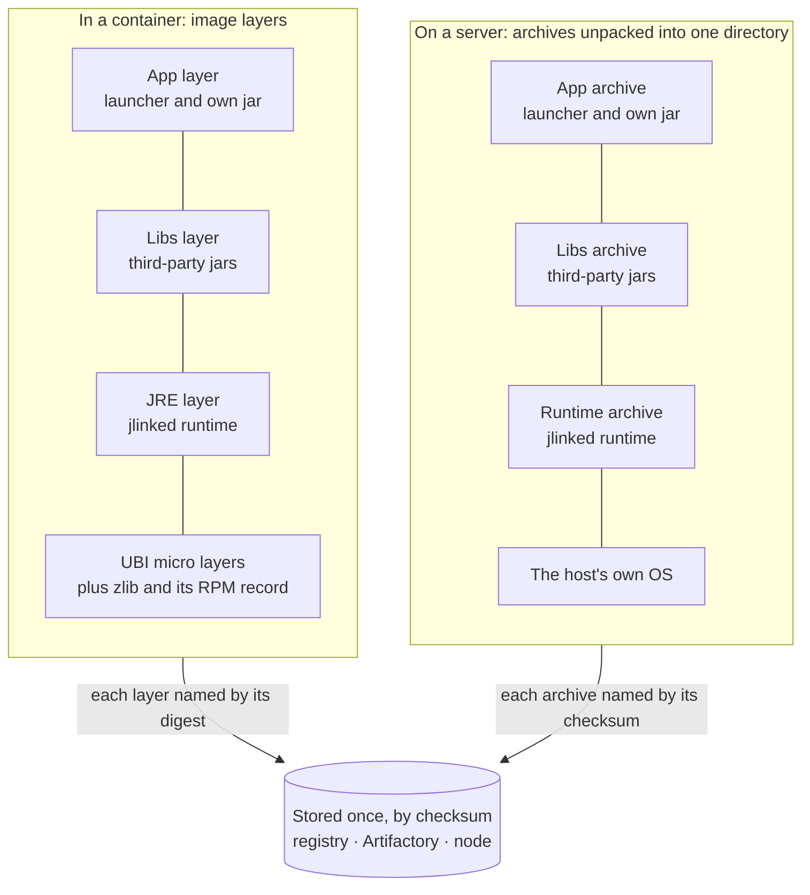

# Image layers and caching

A container registry stores an image as layers, each named by the digest of its contents, and a node pulls only the
layers it doesn't already hold. Artifactory stores every published file the same way, once per checksum. So the more
of a release that is byte-identical to something already stored, the less every release costs. This page is about
what the plugins make identical, and how to keep it that way.

**In short**

- Stack the parts from most reused to least, and split where reuse differs: base, runtime, libraries, app.
- Make sameness an assertion, because nothing fails when it stops.
- Use `images {}`, or `COPY layers/<cpu>/…/ /`: anything else gives a new layer every build.
- Publish from Linux or macOS agents on one JDK, and deploy by checksum.
- Keep four to six module sets, chosen from what you actually ship, and stop short of the compiler.

## Do Not Repeat Yourself

A runtime and a base operating system are the same bytes in thousands of releases. Sending and storing them every
time is repetition, and removing it is why these plugins care about micro, jlink and byte-identical archives. It pays
twice: **a smaller surface** to patch and attack, and **less to transmit and store**.

**Brotli got there first.** [Brotli (RFC 7932)](https://www.rfc-editor.org/rfc/rfc7932) ships a static dictionary of
about 120 KB of common words inside every decoder, so a stream refers to them and never carries them, and
[Shared Brotli (RFC 9841)](https://www.rfc-editor.org/rfc/rfc9841) lets the two sides agree a dictionary of their own.
Don't send what the other side already holds. This is the same idea at a different scale, not the same mechanism
(image layers here are tar and gzip): the base and the runtime are the dictionary, and a release is the short message
that refers to them.

**We used to do this with symlinks.** A JRE went on each host, or on a shared mount, and apps reached it through a
symlink or `JAVA_HOME`. It saved real disk and bandwidth, but nothing tied the link to what had been tested, and an
upgrade made by one team reached everyone's app. There is also nothing left to link to in the old way:
[Oracle's JDK has had no separate JRE since Java 11](https://www.oracle.com/java/technologies/javase/11-relnote-issues.html),
and its release notes point to jlink instead. So every app has a runtime of its own, and without care that is a copy
of it per release.

**The same saving, without the link.** Artifactory
[stores each binary once, by checksum](publishing.md#publishing-the-same-runtime-again), and every path holding those
bytes refers to that copy. That makes each path the old symlink, kept by the store, and it can't point at the wrong
runtime because the name is the content. A
[checksum deploy](https://docs.jfrog.com/artifactory/reference/deployartifactbychecksum) goes one better, creating the
path with no body at all:

```bash
curl -u "$USER:$TOKEN" -X PUT "$REPO/com/example/orders-service-runtime/1.4.2/orders-service-runtime-1.4.2-linux-x64.tar.gz" \
  -H 'X-Checksum-Deploy: true' -H "X-Checksum-Sha256: $(shasum -a 256 runtime.tar.gz | cut -d' ' -f1)"
```

A release then transmits a digest for what the repository already holds. A 404 means it holds no such binary, and the
file has to be uploaded in full. [Publishing](publishing.md#publishing-the-same-runtime-again) shows JFrog's Gradle
plugin doing this for you.

**The discipline comes from Docker, and it works off Docker too.** None of that helps unless the bytes really repeat,
so physical machines take the discipline containers already have: an ordered stack, from what changes least to what
changes most, each part reproducible from its inputs. It is one pattern, and the only difference is what holds the
parts together:



| Part | Holds | In an image | On a server |
|---|---|---|---|
| UBI | The operating system | `from(ubiMicro)`, pinned by digest | The host's own OS; no archive is built |
| JRE | The linked runtime | Its own layer | `<app>-runtime`, its own archive |
| Libs | Third-party jars | Its own layer (`images {}`) | `<app>-libs`, its own archive |
| App | The launcher and your code | Its own layer | `<app>`, the app archive |

The Spring Boot sample on Java 25 shows why: its app archive is 8 KB, its libraries 19.6 MB and its runtime 40.1 MB for
linux-x64, so a release changing only its code adds about 0.01% of new binary. The libraries archive is also the same
bytes on `linux-x64` and `linux-aarch64`. Default `Dockerfile`s and others you wrote yourself keep the app and its
libraries in one layer; `images {}` splits them.

### Without knowing about RPMs

UBI micro has no package manager, and needs one RPM added before Java will start. That shouldn't be something every
team learns, so the plugin takes it on. This is the whole of an image of a Spring Boot app on micro, with an Oracle
Java 25 runtime linked by jlink:

```kotlin
javaApp {
    javaVersion = 25
    images { register("ubi-micro") { from(ubiMicro) } }
}
```

There is no Dockerfile to write and no package named. `./gradlew appImagePackagesLock` pins what the image needs in
`rpms.lock.yaml`, which you commit; `appDockerContext` then writes `Dockerfile.ubi-micro` and fetches those files from
your binary repository, so the image build reaches no repository.
[On UBI micro](container-testing.md#on-ubi-micro) has the rest of the language.

### Tips for caching more

**Prove it with a test.** Nothing fails when two layers stop being the same; storage just grows. So make "the same
bytes" an assertion, on what you actually ship. The sample's
[`UbiMicroTest`](../samples/spring-boot-service/src/dockerTest/java/io/github/fiftieshousewife/samples/spring/UbiMicroTest.java)
builds an image twice, the second time with no cache, and compares digests:

```java
List<String> layers = ContainerTest.layers(ContainerTest.image(DOCKERFILE));
List<String> rebuilt = ContainerTest.layers(ContainerTest.image(DOCKERFILE, "ubi-micro-rebuilt", true));
assertEquals(tail(layers), tail(rebuilt), "rebuilt without the cache");
```

Test the other direction too: a new release must change only what it should. No container engine is needed for this
one. Build the context at two versions and compare each layer's tree, times included, since `COPY` records them:

```kotlin
project.build("appDockerContext")
val first = LAYERS.associateWith { tree(context.resolve("layers/amd64/$it")) }
project.build("appDockerContext", "-PappVersion=2.0.1")
val second = LAYERS.associateWith { tree(context.resolve("layers/amd64/$it")) }
assertEquals(first["runtime"], second["runtime"])
assertEquals(first["libs"], second["libs"])
```

Published files get the same treatment from `appVerifyRuntimeFingerprint`, which
[fails a release](publishing.md#a-check-that-it-still-is) whose runtime changed when its inputs didn't.

**Split layers by how often they can be reused.** Each layer should hold things that are reused about as often as each
other, because one changed file makes the whole layer new. Count the reuses a layer could get:

| Layer | Reused by | Changes |
|---|---|---|
| Base | Every app, on every node | When the pin moves |
| zlib, RPM database, `/licenses` | Every image on that base and runtime | With the base's packages |
| Runtime | Every app on the same JDK patch and module set | Quarterly, with the JDK |
| Libraries | Every release of this app until a dependency moves, on every CPU | Several times a quarter, perhaps |
| The app's own code | Nothing | Every release |

A split is worth making when a part's reuses differ a lot from its neighbours'. If many apps share a framework, that
framework's jars would earn a layer of their own below the app's other libraries; the plugin doesn't make that split
today.

**Keep the most reused at the bottom.** A registry stores a layer by its own digest, but a node's image store shares a
layer only when everything beneath it matches too. So one layer that differs low down costs every layer above it on
the node, however identical they are.

**Compress in one way.** The digests above are of the uncompressed contents; what a registry stores is the compressed
blob. Different gzip output for the same files is a different blob, so build images with one version of one builder,
as runtime archives are published [from one JDK](#republishing-the-runtime).

**Build a ladder of runtimes.** Shared [module sets](#shared-module-sets) work best as rungs, starting with the modules
most apps use and widening: a plain service takes a low rung, and an unusual app takes the top one and shares it, where
it would otherwise get a runtime of its own that nothing shares. The plugin's rungs stop at `server`. Add a last one
yourself if your apps call for it, generated from the JDK, and **stop short of all the modules, as all means the
compiler back in production**. Leave out every development and debugging tool, and whatever your policy forbids (a set
holding a forbidden module is never chosen):

```bash
java --list-modules | sed 's/@.*//' | grep -v -E \
  '^(jdk\.compiler|jdk\.javadoc|jdk\.jshell|jdk\.jdeps|jdk\.jlink|jdk\.jartool|jdk\.jdi|jdk\.jdwp\.agent|jdk\.attach|jdk\.hotspot\.agent|jdk\.jcmd|jdk\.jconsole|jdk\.jpackage|jdk\.jstatd|jdk\.management\.agent|jdk\.editpad|jdk\.incubator\..*|jdk\.internal\..*|jdk\.graal.*|jdk\.jsobject|java\.smartcardio|jdk\.unsupported\.desktop|jdk\.accessibility)$' \
  > production-modules.txt
```

```kotlin
javaApp { moduleSets.put("production", file("production-modules.txt").readLines()) }
```

On Oracle's Java 25 that leaves 40 of 69 modules, in 66 MB, with no `javac`. `java.compiler` stays: it is the
annotation-processing API that frameworks use, not a compiler. Each rung is another runtime a node may hold, so count
your [`MODULES=` lines](#shared-module-sets) to see whether it would be used at all. A list generated from one JDK may
name modules another release lacks; generate it per release.

## What an image is made of

| Layer | Default `Dockerfile` | `images {}` | Changes when |
|---|---|---|---|
| Base | UBI minimal, by tag and digest | `from(…)`, by default UBI minimal, or `ubiMicro` | A plugin release moves the pin, or you do |
| Files | `RUN mkdir` for `/var/lib/app` | RPMs, the RPM database, `/var/lib/app`, `/licenses`, copied from a build stage | The packages or the runtime's licences do |
| Runtime | `COPY layers/<cpu>/runtime/ /` | The same | The JDK or Node.js, or the app's module set |
| Libraries | In the app's layer | `COPY layers/<cpu>/libs/ /` | A dependency moves |
| App | `COPY layers/<cpu>/app/ /` | `COPY layers/<cpu>/code/ /` | Every release |

The base layer is shared by every app built with the same pin, on every node. A release that changes only the app's own
code pushes and pulls only one small layer on `images {}`, and the app and its libraries on the default Dockerfile. The
runtime layer is shared by every app on the same runtime and [module set](#shared-module-sets).

## What is reproducible

- **Archives** are byte-identical when rebuilt from the same commit: fixed timestamps and file order. An unchanged
  release therefore rebuilds to the same image layers.
- **Image layers** of the runtime, libraries and app are byte-identical whichever build, machine or Dockerfile makes
  them: every file in `build/docker-context/` has the same fixed time, and each tree in `layers/<cpu>/` holds the paths
  it takes in the image (`app/runtime/…`), so `COPY … /` creates no directory with the build's own time. A Dockerfile
  copying `runtime/<cpu>/` to `/app/runtime/` instead still builds, but its layer differs every build, since `COPY` makes
  `/app` and `/app/runtime` then.
- **jlink runtimes** are byte-identical for the same JDK, target and module set. Linking the same modules twice gives
  the same `lib/modules` file, so two apps that link the same set ship the same runtime.
- **Runtime archives** are byte-identical across builds and across releases of the app, as long as the runtime's inputs
  are unchanged; see [below](#republishing-the-runtime).
- **Libraries archives** are byte-identical across builds, releases of the app and CPUs, as long as the libraries are
  unchanged: they name neither the app nor its version, and modes depend only on a file's exec bit. A project
  dependency's jar goes in the app archive instead, as its name holds its version.
- **RPMs** are not byte-identical (see [Packaging standards](packaging-standards.md)), so they are not published; they
  don't affect images.

## Republishing the runtime

Each release publishes its runtime archive again ([Publishing](publishing.md#publishing-the-same-runtime-again)), which
costs nothing only while the bytes are the same. Nothing fails when they stop being so; storage just grows. These are
what could make them differ, and what the plugins do about each. Each row was a real difference somewhere along the way,
or a known one avoided:

| Could differ | What the plugins do |
|---|---|
| The JDK | One exact version, the pin, for every build. Gradle resolves it as a dependency, so `gradle/verification-metadata.xml` can pin its SHA-256 too, which catches a vendor re-releasing a version |
| The app's name or version | Neither is in the runtime archive: its one directory is `runtime/`, and the version is only in the file's name |
| Times and order | Every entry has the same fixed time, in a fixed order |
| Modes | 0755 for the runtime's executables (`bin/`, `jspawnhelper`, `jexec`), 0644 for every other file and 0755 for directories: by path alone, never from the build machine's file system, which on Windows has no modes and elsewhere depends on the umask |
| jlink's own output | Reproducible for the same JDK, modules and options since the fixes for [JDK-8241602](https://bugs.openjdk.org/browse/JDK-8241602) and [JDK-8252730](https://bugs.openjdk.org/browse/JDK-8252730), which covered images built on different machines |
| Debug symbols | `--strip-java-debug-attributes`, not `--strip-debug`: on Linux that also runs the build machine's `objcopy` over the native libraries, and its output depends on that machine's binutils |
| The module list | A [shared set](#shared-module-sets), or the app's own modules sorted |
| Class data sharing | No `--generate-cds-archive`, whose output has not been deterministic |
| Trusted certificates | Written as the JDK's own `cacerts` is, with no password, MAC or encryption: those add random salts, and Java 17's JKS format dates every entry. The same certificates give the same file whichever JDK runs Gradle; a Java 17 runtime's `cacerts` becomes PKCS12, which Java 17 reads |
| The build machine | Linux and macOS agents give the same bytes for every target, Windows targets included. A Windows agent doesn't: its jlink writes `release` with CRLF line endings, writes duplicate legal notices as `Please see ..\java.base\LICENSE` pointers where the others copy the text, and generates some `java.lang.invoke` classes in `lib/modules` differently. Publish runtimes from Linux or macOS agents |
| Compression | gzip by the JVM that runs Gradle. Publish from agents that run Gradle on the same JDK, with Gradle's [daemon JVM criteria](https://docs.gradle.org/current/userguide/gradle_daemon.html#sec:daemon_jvm_criteria), say |

`appVerifyRuntimeFingerprint` catches any of these before a release is published: it fails when a runtime's inputs equal
the previous release's but its archive doesn't ([Publishing](publishing.md#a-check-that-it-still-is)). The plugins' own
tests rebuild a runtime archive from scratch, and with a new app version, and compare the checksums. CI does the same
for every target on Linux, macOS and Windows agents, then checks that the Linux and macOS agents built the same bytes
for each target, and reports how the Windows agent's differ.

### What Gradle caches

- **`jlink<Target>` and `customiseRuntime<Target>` are cacheable**, keyed by the pin, the build target, whether the build
  machine runs Windows, the modules, the jlink options, the certificates, the policy and the overlay: not the app's code
  or version. A change to the app doesn't link the runtime again, and a build cache hit restores the same bytes a link
  would have made.
- **The JDKs themselves aren't hashed** (their pin is the input), so a JDK replaced on disk under the same version isn't
  noticed; dependency verification is what catches that.
- **The build machine is not part of the key,** only whether it runs Windows: Linux and macOS agents link the same bytes,
  so a shared build cache serves a runtime linked on a Mac to a Linux agent. A Windows agent's link differs, so it never
  shares one with them.
- **`appRuntimeArchive<Target>` runs again for a new version,** since the version is in its file's name, and writes the
  same bytes. Archive tasks are never cached; this one only copies.
- **Gradle's dependency cache is keyed by coordinates,** not content, so a build that resolves each release,
  `app-smoke-test` say, downloads the same runtime again under each version. A server can keep one copy per checksum
  instead: see [One runtime per host](packaging.md#one-runtime-per-host).

## Shared module sets

By default an app's runtime is the smallest of a few fixed module sets that holds every module it needs, rather than
exactly those modules, so apps on the same set, JDK and target ship the same runtime. The sets, their sizes and how to
change them are in [Java: modules, hardening and JDKs](java.md#shared-module-sets). Some heuristics for choosing them:

- **Few, wide sets share more.** Each extra set splits the apps further. JDK 21 has 69 modules and about 86 trillion
  valid combinations, but apps cluster by framework: plain services need two or three modules, Spring Boot about
  eighteen. Sets a few MB apart save each app little and cost every node another runtime to hold; four to six sets is a
  sensible range.
- **The JVM is a fixed cost.** About 20 MB of every runtime is the JVM itself, whatever the modules, so the most a
  smaller set saves is the difference in `lib/modules`: about 11 MB for `java.base` and the HTTP server, about 50 MB with
  every module.
- **Patches reset everything.** A new JDK patch, quarterly, changes every runtime whatever its set. Sharing pays between
  patches, and across apps on the same patch.
- **Choose sets from your own apps.** Every runtime archive records its modules on the `MODULES=` line of
  `runtime/release`. Counting the distinct lines across the runtime archives you publish shows which sets would cover
  most of them:

  ```bash
  for archive in *-runtime-*.tar.gz; do
    tar -xzOf "$archive" runtime/release | grep '^MODULES='
  done | sort | uniq -c | sort -rn
  ```

- **Keep debugging modules out of shared sets.** A set holding a module in `security.forbiddenModules` is never chosen,
  so an app that needs one gets exactly its own modules, and the exception stays visible.
- **Decide about locales on purpose.** Only `server` holds `jdk.localedata`. Below it, German dates come out in English
  with no error ([Testing the container image](container-testing.md#what-goes-wrong-in-containers)), so an app with
  users outside English belongs on `server`, whatever jdeps finds.

## Checking what you ship

- **Which set an app got:** the `MODULES=` line of `runtime/release` in its runtime archive.
- **Whether two images share a runtime:** compare the digests each one lists in
  `docker image inspect --format '{{json .RootFS.Layers}}' <image>`. On the default Dockerfile the runtime's layer is the
  second to last, and the last is the app's; on `images {}`, it is the third to last, then the libraries, then the app.
- **Whether a rebuild is identical:** build the same commit twice and compare the archives' checksums.
- **Whether two releases share a runtime:** compare the SHA-256 of their runtime archives, which Artifactory's storage
  API gives (`/api/storage/<repo>/<path>`, `checksums.sha256`) without a download.
